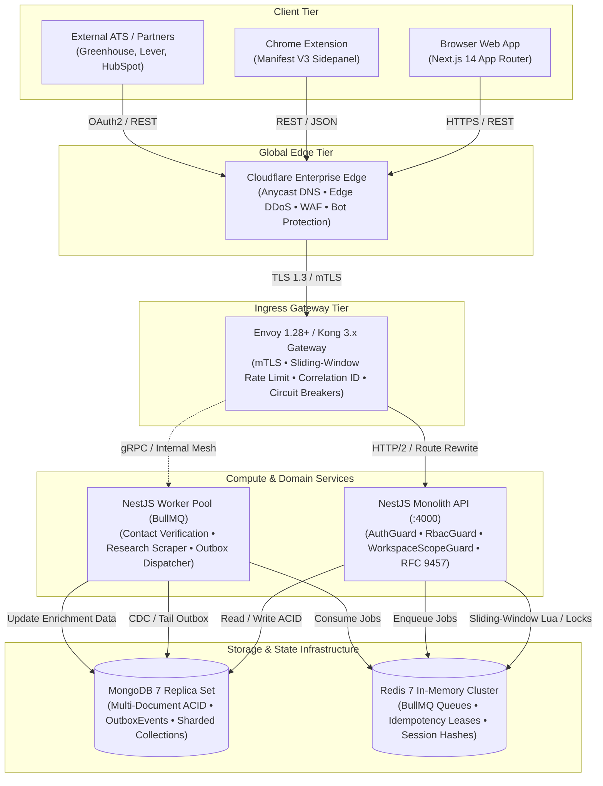
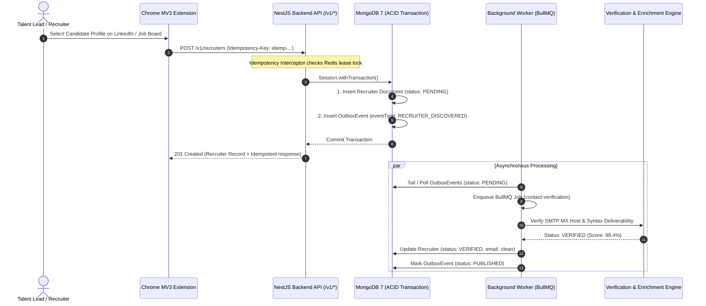
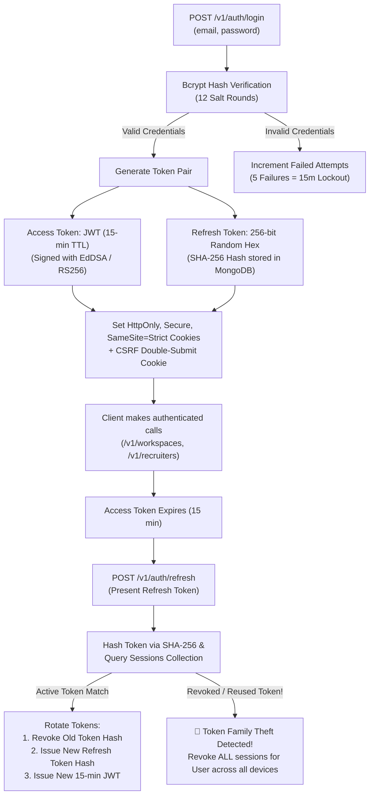
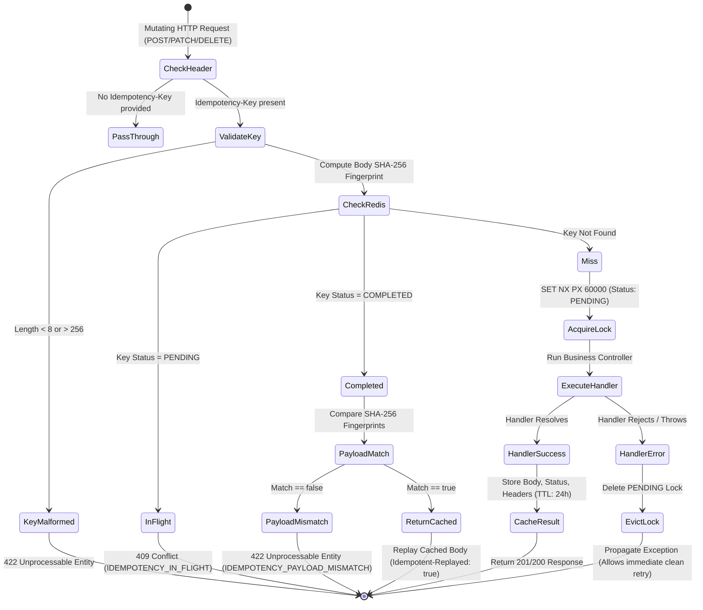
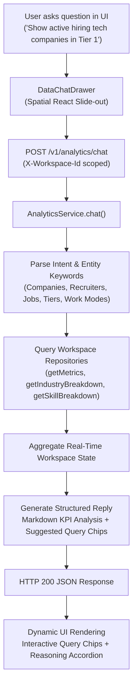

# Career Intelligence OS

[](https://github.com/Hellthefox808/AI-OUTREACH-AND-MAIL/actions/workflows/ci-fe.yml)
[](https://github.com/Hellthefox808/AI-OUTREACH-AND-MAIL/actions/workflows/ci-be.yml)
[](https://www.typescriptlang.org/)
[](https://nextjs.org/)
[](https://nestjs.com/)
[](https://www.mongodb.com/)
[](https://redis.io/)
[](https://www.envoyproxy.io/)
[-brightgreen.svg)](tests/)
[](LICENSE)

> **Enterprise Career Intelligence, Target Company Research, Recruiter Discovery, Opportunity Mapping, and Automated Outbound Intelligence Platform.**

Engineered for **1,000,000+ users** with an **Apple-inspired Spatial Glassmorphism & 4D Motion Engine**, strict multi-tenant workspace isolation (`workspaceId`), deterministic cryptographic token security, distributed BullMQ asynchronous queue orchestration, RFC 9457 Problem Details error contracts, and declarative Envoy/Kong ingress gateways.

---

## Table of Contents

1. [System Architecture & Topology](#1-system-architecture--topology)
2. [End-to-End System Workflows](#2-end-to-end-system-workflows)
   - [2.1 Candidate Discovery & Outbox Pipeline Workflow](#21-candidate-discovery--outbox-pipeline-workflow)
   - [2.2 Zero-Trust Authentication & Token Rotation Lifecycle](#22-zero-trust-authentication--token-rotation-lifecycle)
   - [2.3 Distributed Idempotency Key State Machine](#23-distributed-idempotency-key-state-machine)
   - [2.4 Durable Webhook Delivery Pipeline](#24-durable-webhook-delivery-pipeline)
   - [2.5 AI Data Chat & Real-Time Analytics Engine](#25-ai-data-chat--real-time-analytics-engine)
3. [Spatial UI/UX & 4D Motion Engine](#3-spatial-uiux--4d-motion-engine)
4. [Monorepo Directory Layout & Boundaries](#4-monorepo-directory-layout--boundaries)
5. [Enterprise API Specification (`/v1/*`)](#5-enterprise-api-specification-v1)
6. [Architecture Decision Records (ADRs)](#6-architecture-decision-records-adrs)
7. [Security & DevSecOps Invariants](#7-security--devsecops-invariants)
8. [Getting Started & Local Setup](#8-getting-started--local-setup)
9. [Verification & Testing Protocol](#9-verification--testing-protocol)
10. [Operational Scripts Reference](#10-operational-scripts-reference)
11. [Contributing & Community Guidelines](#11-contributing--community-guidelines)
12. [License](#12-license)

---

## 1. System Architecture & Topology

Career Intelligence OS is structured as a high-concurrency monorepo powered by **pnpm 9** and **Turborepo**. The dual-layer ingress topology decouples global edge security from internal application compute:



---

## 2. End-to-End System Workflows

### 2.1 Candidate Discovery & Outbox Pipeline Workflow

Mutations that trigger asynchronous background enrichment (email verification, company research, ATS export) utilize the **Transactional Outbox Pattern** to prevent dual-write inconsistencies:



---

### 2.2 Zero-Trust Authentication & Token Rotation Lifecycle

Human sessions utilize **Short-Lived Asymmetric JWTs** combined with **Opaque Refresh Tokens** that rotate deterministically on every refresh invocation:



---

### 2.3 Distributed Idempotency Key State Machine

Mutating HTTP operations (`POST`, `PUT`, `PATCH`, `DELETE`) pass through the `IdempotencyInterceptor` adhering to IETF draft standards:



---

### 2.4 Durable Webhook Delivery Pipeline

Outbound webhooks notify external partner systems (Greenhouse, Lever, HubSpot) with cryptographic tamper-proofing and automated backoff retries:

```mermaid
flowchart LR
    OUTBOX["MongoDB\nOutboxEvents"] -->|CDC / Watch| STREAM["Worker Dispatcher\n(BullMQ)"]
    STREAM --> SIGN["Compute HMAC-SHA256\n(Secret, Timestamp + Payload)"]
    SIGN --> DISPATCH["HTTP POST Dispatch\nX-Signature-SHA256\nX-Timestamp\nX-Event-ID"]

    DISPATCH -->|2xx Success| SUCCESS["Mark Event\nPUBLISHED"]
    DISPATCH -->|4xx / 5xx / Timeout| RETRY["Exponential Backoff with Full Jitter\n(1m, 5m, 15m, 1h, 6h, 24h)"]

    RETRY -->|Retry Limit Exceeded (7 attempts)| DLQ["Dead Letter Queue (DLQ)\n(Incident Diagnostic Logged)"]
    DLQ -->|50 Continuous Failures| SUSPEND["Auto-Suspend Endpoint\n(Admin Alert Dispatched)"]
```

---

### 2.5 AI Data Chat & Real-Time Analytics Engine

The platform features an embedded natural language query engine (`POST /v1/analytics/chat`) and interactive slide-out drawer for instant organizational intelligence:



---

## 3. Spatial UI/UX & 4D Motion Engine

The interface implements an Apple-inspired spatial computing design language balancing aesthetic depth with WCAG 2.2 AA accessibility and 60fps rendering:

```
┌────────────────────────────────────────────────────────────────────────┐
│ Layer 5: Elevated Crystal Modals & Focus Traps (z-50)                  │
├────────────────────────────────────────────────────────────────────────┤
│ Layer 4: Contextual Floating Floating Action Pills & Tooltips (z-40)   │
├────────────────────────────────────────────────────────────────────────┤
│ Layer 3: Interactive Frosted Glass Cards, KPI Sparks & Tables (z-30)   │
├────────────────────────────────────────────────────────────────────────┤
│ Layer 2: Ambient Glass Shell, Frosted Sidebar & App Header (z-20)     │
├────────────────────────────────────────────────────────────────────────┤
│ Layer 1: 4D Particle Constellation Engine (Canvas 2D / Parallax) (z-10)│
├────────────────────────────────────────────────────────────────────────┤
│ Layer 0: Obsidian Ground Mesh (#080a0f) + Specular Radial Light (z-0)  │
└────────────────────────────────────────────────────────────────────────┘
```

- **Material Tiers**: `ambient` (navigation backdrop), `frosted` (data tables), `crystal` (interactive cards with specular borders), and `dark` (drawers).
- **4D Particle Engine $(X, Y, Z, T)$**: Canvas 2D simulation calculating lateral drift ($X, Y$), perspective depth parallax ($Z \in [0.2, 1.0]$), and harmonic wave oscillation over time ($T$), with pointer repulsion and Page Visibility API sleep throttling.
- **Micro-Interaction Tokens**: Durations calibrated across `instant: 100ms`, `micro: 160ms`, `standard: 220ms`, `smooth: 320ms`, `spatial: 450ms`, and `cinematic: 650ms`, with full `@media (prefers-reduced-motion)` pause enforcement.

---

## 4. Monorepo Directory Layout & Boundaries

```
career-intelligence-os/
│
├── apps/
│   ├── fe/                  # Next.js 14 App Router, React 18, Tailwind UI, Spatial Glassmorphism
│   │   ├── src/app/         # Dashboard, Companies, Recruiters, Jobs, Auth routes
│   │   ├── src/components/  # Spatial Cards, Modals, Tables, Particles, DataChatDrawer
│   │   └── src/lib/         # Typed API Client SDK with credentials & error mapping
│   │
│   ├── be/                  # NestJS Core API Modular Monolith
│   │   ├── src/common/      # AuthGuard, RbacGuard, WorkspaceScopeGuard, RFC 9457 Filter, Idempotency
│   │   └── src/modules/     # Auth, Workspaces, Users, Companies, Recruiters, Jobs, Analytics, Outbox
│   │
│   ├── worker/              # BullMQ distributed queue processors (isolated execution unit)
│   │   └── src/modules/     # CompanyResearchProcessor, ContactVerificationProcessor, JobDiscovery
│   │
│   └── extension/           # Chrome Manifest V3 Extension (Sidepanel, Popup, Background Worker)
│
├── packages/
│   ├── database/            # Mongoose schemas, compound indexes, BaseRepository, DatabaseModule
│   ├── shared/              # Domain schemas (Zod), branded IDs, permissions, RFC 9457 errors
│   └── ui/                  # Reusable UI primitives (Button, Input, Card, Modal, Badge, Table)
│
├── infrastructure/
│   ├── docker/              # Local Docker Compose manifests (MongoDB 7 & Redis 7)
│   └── gateway/             # Ingress configurations (envoy.yaml, kong.yaml)
│
├── docs/                    # Architecture documentation & ADR index
│   ├── architecture/        # Database & Scalability, Enterprise API Engineering, Boundaries
│   └── architecture-decisions/ # ADR-001 through ADR-010
│
├── tests/                   # Monorepo E2E and integration suites
│   ├── e2e/tier1-features/  # Auth, Companies, Recruiters, Jobs, Workspaces, Health, Workers
│   ├── e2e/tier2-boundaries/# Security, Tenancy, Pagination, Auth Boundaries
│   ├── e2e/tier3-combinations/ # Cross-Feature Integration Combinations
│   └── e2e/tier4-scenarios/ # Enterprise Real-World High-Scale Scenarios
│
└── .github/                 # Workflows (ci-fe.yml, ci-be.yml), Security Policy, Issue Templates
```

---

## 5. Enterprise API Specification (`/v1/*`)

All REST endpoints adhere strictly to **RFC 9457 Problem Details** (`application/problem+json`), enforce **Keyset Pagination**, and support the IETF `Idempotency-Key` header on mutating operations.

### Endpoints Inventory

| Method | Endpoint | Description | Permissions Required |
|---|---|---|---|
| `POST` | `/v1/auth/register` | Register new user & bootstrap workspace | `@Public()` |
| `POST` | `/v1/auth/login` | Authenticate & issue dual-token cookies | `@Public()` |
| `POST` | `/v1/auth/refresh` | Rotate access & refresh token pair | `@Public()` |
| `POST` | `/v1/auth/logout` | Revoke active session via SHA-256 hash | Authenticated |
| `GET` | `/v1/auth/me` | Retrieve authenticated profile & roles | `@WorkspaceAgnostic()` |
| `GET` | `/v1/workspaces` | List accessible workspace tenants | Authenticated |
| `POST` | `/v1/workspaces` | Provision new workspace & seed RBAC roles | Authenticated |
| `GET` | `/v1/companies` | List companies with multi-filter & cursor | `COMPANIES_READ` |
| `POST` | `/v1/companies` | Create target company profile | `COMPANIES_WRITE` |
| `GET` | `/v1/companies/export` | Export companies to CSV or JSON format | `COMPANIES_READ` |
| `GET` | `/v1/companies/:id` | Retrieve company dossier & metadata | `COMPANIES_READ` |
| `PATCH` | `/v1/companies/:id` | Update company profile details | `COMPANIES_WRITE` |
| `DELETE` | `/v1/companies/:id` | Soft-delete company record | `COMPANIES_WRITE` |
| `GET` | `/v1/recruiters` | List talent contacts with deliverability score | `RECRUITERS_READ` |
| `POST` | `/v1/recruiters` | Add recruiter & trigger verification worker | `RECRUITERS_WRITE` |
| `GET` | `/v1/recruiters/export`| Export recruiters to CSV or JSON format | `RECRUITERS_READ` |
| `GET` | `/v1/recruiters/:id` | Retrieve recruiter profile & verification state | `RECRUITERS_READ` |
| `PATCH` | `/v1/recruiters/:id` | Update contact information | `RECRUITERS_WRITE` |
| `DELETE` | `/v1/recruiters/:id` | Soft-delete recruiter record | `RECRUITERS_WRITE` |
| `GET` | `/v1/jobs` | List job requisitions with work mode filter | `JOBS_READ` |
| `POST` | `/v1/jobs` | Create new job posting | `JOBS_WRITE` |
| `GET` | `/v1/jobs/export` | Export job postings to CSV or JSON format | `JOBS_READ` |
| `GET` | `/v1/jobs/:id` | Retrieve job requisition details | `JOBS_READ` |
| `PATCH` | `/v1/jobs/:id` | Update requisition status or URL | `JOBS_WRITE` |
| `DELETE` | `/v1/jobs/:id` | Soft-delete job record | `JOBS_WRITE` |
| `GET` | `/v1/analytics/overview`| Retrieve aggregated workspace KPIs | `ANALYTICS_READ` |
| `GET` | `/v1/analytics/breakdown`| Sector heatmap, deliverability, skills | `ANALYTICS_READ` |
| `POST` | `/v1/analytics/chat` | Natural language analytics AI assistant | `ANALYTICS_READ` |
| `GET` | `/v1/health` | Service liveness, readiness, and DB ping | `@Public()` |

---

## 6. Architecture Decision Records (ADRs)

Key architectural decisions are preserved in formal records:

| ADR | Title | Decision Summary | Status |
|---|---|---|---|
| [**ADR-001**](docs/architecture-decisions/ADR-001-monorepo.md) | Turborepo Monorepo Architecture | Monorepo structure with pnpm workspaces for strict boundary enforcement | Accepted |
| [**ADR-002**](docs/architecture-decisions/ADR-002-package-management.md) | Package Management Strategy | Deterministic package management using pnpm 9 lockfile integrity | Accepted |
| [**ADR-003**](docs/architecture-decisions/ADR-003-application-boundaries.md) | Monorepo Application Boundaries | Direct database access restricted to backend; frontend and extension mediate via REST | Accepted |
| [**ADR-004**](docs/architecture-decisions/ADR-004-deployment-strategy.md) | Container Deployment Strategy | Production multi-stage Docker builds deploying independent services | Accepted |
| [**ADR-005**](docs/architecture-decisions/ADR-005-database-and-polyglot-persistence.md) | Polyglot Persistence Architecture | MongoDB 7 for transactional documents; Redis 7 for cache, locks, and queues | Accepted |
| [**ADR-006**](docs/architecture-decisions/ADR-006-transactional-outbox-and-event-streaming.md) | Transactional Outbox Pattern | ACID multi-document transactions emit OutboxEvents to prevent dual-writes | Accepted |
| [**ADR-007**](docs/architecture-decisions/ADR-007-multi-tenant-sharding-and-partitioning.md) | Multi-Tenant Sharding Strategy | Compound B-tree indexes prefixed by `workspaceId` for total tenant isolation | Accepted |
| [**ADR-008**](docs/architecture-decisions/ADR-008-api-gateway-and-contract-first-governance.md) | API Gateway & Contract Governance | Dual-layer edge (Cloudflare) + Ingress (Envoy/Kong) with OpenAPI 3.1 & Spectral | Accepted |
| [**ADR-009**](docs/architecture-decisions/ADR-009-idempotency-and-webhook-delivery-pipeline.md) | Idempotency & Webhook Pipeline | IETF `Idempotency-Key` distributed state machine + HMAC-SHA256 durable webhooks | Accepted |
| [**ADR-010**](docs/architecture-decisions/ADR-010-api-security-and-zero-trust-authorization.md) | Zero-Trust API Security & RFC 9457 | Global guard chain (`Auth`, `Rbac`, `WorkspaceScope`) + RFC 9457 error contracts | Accepted |

---

## 7. Security & DevSecOps Invariants

1. **Workspace Boundary Invariant**: Every database query is mathematically scoped to `{ workspaceId: request.workspaceId }`. Cross-tenant lookups (BOLA / IDOR) are rejected by global guards before controller execution.
2. **Token Integrity**: High-entropy tokens (session hashes, refresh hashes, password reset tokens) are stored exclusively as deterministic **SHA-256 hex digests**. Raw tokens are never persisted in plaintext.
3. **Password Security**: Passwords hashed with **Bcrypt (12 rounds)**. 5 consecutive invalid login attempts trigger an automatic 15-minute account lockout.
4. **RFC 9457 Problem Details**: Standardized error payloads (`type`, `title`, `status`, `detail`, `instance`, `requestId`) protect internal stack traces and topologies in production.
5. **SSRF Defense**: External webhook dispatchers validate target IPs against RFC 1918 private subnets (`10.0.0.0/8`, `172.16.0.0/12`, `192.168.0.0/16`, `127.0.0.0/8`) and cloud metadata endpoints (`169.254.169.254`).
6. **Zero-Placeholder Law**: All deliverables are complete, production-hardened, and typed with zero `// TODO`, `...`, or stub implementations.

---

## 8. Getting Started & Local Setup

### Prerequisites
- **Node.js**: `>= 20.0.0`
- **pnpm**: `9.x` (`npm install -g pnpm@9`)
- **Docker & Docker Compose**: For local MongoDB 7 and Redis 7 instances

### Step-by-Step Local Deployment

```bash
# 1. Clone repository
git clone https://github.com/Hellthefox808/AI-OUTREACH-AND-MAIL.git
cd AI-OUTREACH-AND-MAIL

# 2. Configure environment variables
cp .env.example .env

# 3. Install dependencies across all packages
pnpm install

# 4. Start backing databases via Docker Compose
docker compose -f infrastructure/docker/docker-compose.yml up -d

# 5. Run the complete quality verification protocol
pnpm run validate
pnpm run test:e2e

# 6. Launch all applications in parallel development mode
pnpm run dev
```

### Access Points
- **Web Dashboard**: `http://localhost:3000`
- **Backend API**: `http://localhost:4000/v1`
- **OpenAPI Swagger UI**: `http://localhost:4000/docs`
- **MongoDB Health**: `http://localhost:4000/v1/health`

---

## 9. Verification & Testing Protocol

The codebase includes comprehensive unit, integration, boundary, and scenario test suites:

```bash
# Execute unit test suites across all 5 testable packages (59 tests)
pnpm run test

# Execute complete End-to-End test matrix (127 tests)
pnpm run test:e2e

# Strict TypeScript typechecking across all 7 monorepo packages
pnpm run typecheck

# Full production build of Next.js, NestJS backend, and worker
pnpm run build
```

### Test Suite Distribution

| Category | Suite Path | Tests | Coverage Scope |
|---|---|:---:|---|
| **Tier 1: Features** | `tests/e2e/tier1-features/` | 77 | Auth, Companies, Recruiters, Jobs, Workspaces, Health, Workers |
| **Tier 2: Boundaries** | `tests/e2e/tier2-boundaries/` | 40 | Security, Multi-Tenancy BOLA, Keyset Pagination, Auth Guard |
| **Tier 3: Combinations**| `tests/e2e/tier3-combinations/` | 6 | Cross-Feature Interoperability & Lifecycle Cascades |
| **Tier 4: Scenarios** | `tests/e2e/tier4-scenarios/` | 4 | Enterprise High-Scale Pagination & Threat Incident Simulation |
| **Monorepo Units** | `apps/*/src/**/*.spec.ts` | 59 | Guards, Interceptors, Filters, Services, Frontend API SDK |
| **Total Test Suite** | — | **186** | **100% Green (Zero Failures)** |

---

## 10. Operational Scripts Reference

| Command | Action |
|---|---|
| `pnpm run dev` | Launch all monorepo applications in parallel via Turborepo |
| `pnpm run dev:fe` | Launch Next.js 14 frontend application only (`:3000`) |
| `pnpm run dev:be` | Launch NestJS core backend API only (`:4000`) |
| `pnpm run dev:worker` | Launch BullMQ worker processor only |
| `pnpm run dev:extension` | Launch Chrome Extension build in watch mode |
| `pnpm run typecheck` | Run strict `tsc --noEmit` across all 7 packages |
| `pnpm run lint` | Run ESLint with auto-fixing across monorepo |
| `pnpm run test` | Run Vitest unit & integration test suites |
| `pnpm run test:e2e` | Run Vitest multi-tier end-to-end test suite |
| `pnpm run build` | Compile optimized production build artifacts for all packages |
| `pnpm run validate` | Execute CI quality gate: `typecheck && lint && test` |

---

## 11. Contributing & Community Guidelines

We welcome engineering contributions! Please review our [Contributing Guidelines](.github/CONTRIBUTING.md) and [Security Policy](.github/SECURITY.md) prior to submitting pull requests.

1. Create a feature branch: `git checkout -b feat/my-enhancement`.
2. Ensure all quality gates pass: `pnpm run validate && pnpm run test:e2e && pnpm run build`.
3. Commit using conventional commit format: `feat(api): add webhook subscription endpoints`.
4. Push to remote and open a Pull Request.

---

## 12. License

This repository is licensed under the terms of the [MIT License](LICENSE).
