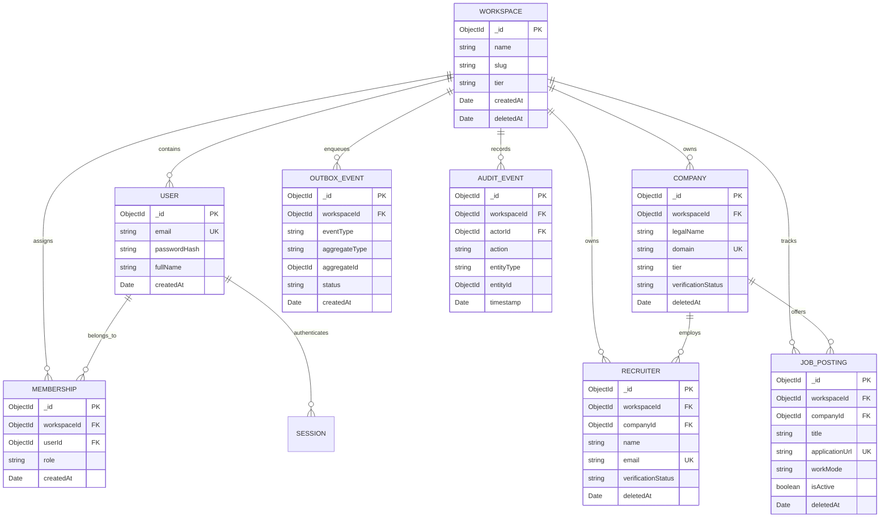
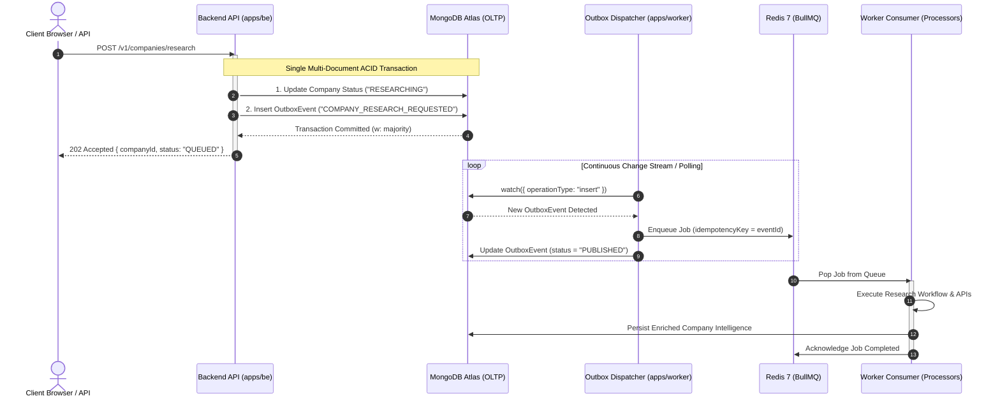
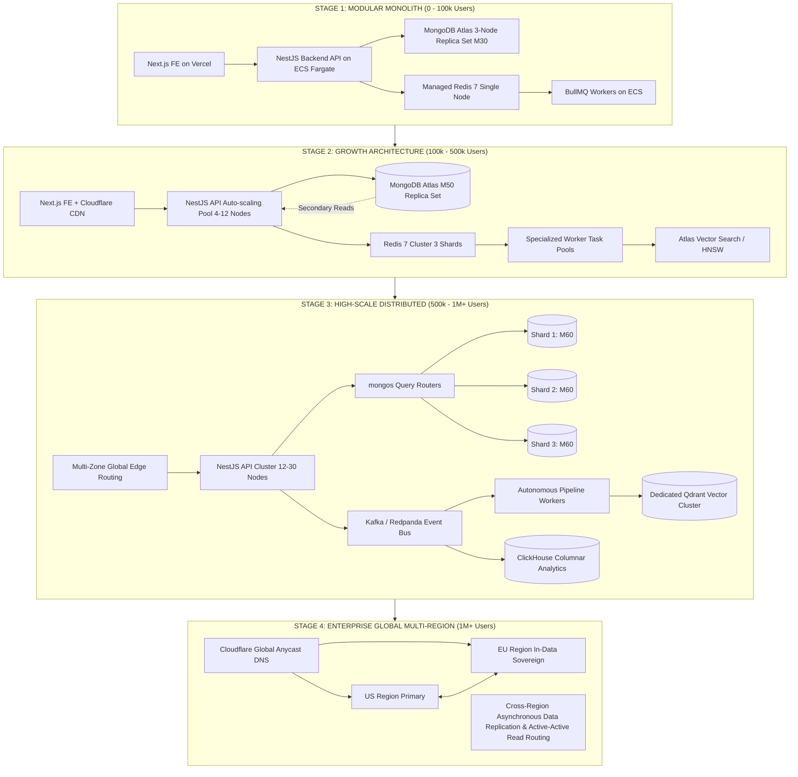

# Enterprise Database, Data Pipeline & Scalability Intelligence Blueprint
## Career Intelligence OS | Distributed Architecture for 1,000,000+ Users

---

### Executive Architectural Charter

This document defines the production data engineering, database topology, distributed asynchronous pipeline, and progressive scalability architecture for **Career Intelligence OS**. It establishes the formal technical requirements, quantitative capacity sizing models, compound indexing specifications, transaction isolation boundaries, high-availability failover protocols, and FinOps unit economics required to scale the platform from Day-1 through **1,000,000+ registered users**, **120,000 Daily Active Users (DAU)**, and **15,000 peak concurrent sessions**.

---

## 1. Quantitative Workload & Sizing Model (1M+ Users)

### 1.1 Fundamental User & Traffic Invariants

The quantitative sizing model is derived from standard enterprise B2B SaaS usage patterns for recruitment, outbound sourcing, and job intelligence:

$$\text{Total Registered Users } (N_{\text{total}}) = 1,000,000$$
$$\text{Total Workspaces } (N_{\text{ws}}) = 100,000 \quad (\text{Average } 10 \text{ members / workspace})$$
$$\text{Monthly Active Users } (\text{MAU}) = 350,000 \quad (35\% \text{ of registered base})$$
$$\text{Daily Active Users } (\text{DAU}) = 120,000 \quad (\approx 34.3\% \text{ DAU/MAU ratio})$$
$$\text{Peak Concurrent Users } (\text{PCU}) = 15,000 \quad (\approx 12.5\% \text{ of DAU during peak 4-hour window})$$

### 1.2 Transactional Throughput Calculations

During the 4-hour peak window ($T_{\text{peak}} = 14,400\text{ seconds}$), each concurrent active user generates an average of $2.4$ user-driven interactions per minute (page navigations, candidate lookups, status updates, search filters):

$$\text{User Interaction Rate } (\lambda_{\text{user}}) = \frac{2.4}{60} = 0.04 \text{ actions/sec/user}$$
$$\text{Peak API Request Rate } (\text{RPS}_{\text{api}}) = 15,000 \times 0.04 \times 4.16 \approx 2,500 \text{ Requests/sec}$$

#### Read-to-Write Ratio
- **Read Requests (85%):** Dashboard hydration, recruiter contact views, job board searches, company intelligence lookups, filter aggregations.
$$\text{Peak Read Throughput } (\text{RPS}_{\text{read}}) = 2,500 \times 0.85 = 2,125 \text{ Read QPS}$$
- **Write Requests (15%):** Lead status changes, campaign creations, approval triggers, note additions, session updates, user profile modifications.
$$\text{Peak Write Throughput } (\text{RPS}_{\text{write}}) = 2,500 \times 0.15 = 375 \text{ Write QPS}$$

#### Asynchronous Queue Ingestion Rate
In addition to direct user traffic, automated crawler agents and worker pools continuously generate asynchronous background operations:
- Contact verification jobs: $500,000\text{ jobs/day} \approx 5.8\text{ jobs/sec}$ (peak $35\text{ jobs/sec}$).
- Company research & enrichment jobs: $250,000\text{ jobs/day} \approx 2.9\text{ jobs/sec}$ (peak $20\text{ jobs/sec}$).
- Job discovery & scraping jobs: $450,000\text{ jobs/day} \approx 5.2\text{ jobs/sec}$ (peak $25\text{ jobs/sec}$).
- Aggregate Peak Asynchronous Queue Ingestion: $\approx 80 \text{ jobs/sec}$.

### 1.3 Storage Footprint & Monthly Growth Trajectory

| Entity Collection | Doc Size (Avg) | Initial Vol (100k Users) | 1M Users Volume | Initial Storage | 1M Storage | Monthly Growth (1M Users) |
| :--- | :--- | :--- | :--- | :--- | :--- | :--- |
| **`Workspaces`** | 1.2 KB | 10,000 | 100,000 | 12 MB | 120 MB | 5 MB |
| **`Users`** | 1.8 KB | 100,000 | 1,000,000 | 180 MB | 1.8 GB | 75 MB |
| **`Memberships`** | 0.6 KB | 120,000 | 1,200,000 | 72 MB | 720 MB | 30 MB |
| **`Sessions`** | 0.8 KB | 250,000 (active) | 2,500,000 | 200 MB | 2.0 GB | Ephemeral (TTL 30d) |
| **`Companies`** | 4.5 KB | 1,000,000 | 10,000,000 | 4.5 GB | 45.0 GB | 1.8 GB |
| **`Recruiters`** | 2.2 KB | 5,000,000 | 50,000,000 | 11.0 GB | 110.0 GB | 4.4 GB |
| **`JobPostings`** | 3.5 KB | 2,500,000 | 25,000,000 | 8.75 GB | 87.5 GB | 3.5 GB |
| **`OutboxEvents`** | 1.5 KB | Ephemeral | Ephemeral | 1.5 GB | 15.0 GB | Rotated (TTL 7d) |
| **`AuditEvents`** | 1.0 KB | 20,000,000 | 200,000,000 | 20.0 GB | 200.0 GB | 18.0 GB |
| **Total Operational Data** | — | **~28.9M docs** | **~289.8M docs** | **46.2 GB** | **462.1 GB** | **~27.8 GB / month** |

*Index Overhead:* Compound B-tree indexes consume an estimated $35\%$ of raw collection size $\approx 161.7\text{ GB}$.  
*Working Set Memory (RAM Target):* WiredTiger cache must hold all active B-tree indexes plus the 20% active document working set:
$$\text{RAM}_{\text{working\_set}} = 161.7\text{ GB (indexes)} + (0.20 \times 462.1\text{ GB}) \approx 254.1\text{ GB}$$
*Cluster RAM Provisioning:* $4 \times \text{M60 (64 GB RAM)}$ or $2 \times \text{M80 (128 GB RAM)}$ nodes across a 3-shard cluster ensures 100% in-memory working-set residency.

---

## 2. Comprehensive Database Technology Evaluation Matrix

The selection of persistence engines is governed by workload characteristics, isolation requirements, write amplification factors (WAF), and maintenance complexity:

| Architecture Criterion | MongoDB 7.0 (Selected OLTP) | PostgreSQL 16 (Relational Alternative) | ClickHouse (Selected OLAP) | Redis 7.2 (Selected Cache/Queue) | Qdrant (Vector Engine) | Apache Iceberg (Data Lake) |
| :--- | :--- | :--- | :--- | :--- | :--- | :--- |
| **Primary Workload** | Polymorphic Documents, Multi-Tenant OLTP | Rigid Relational OLTP | High-Throughput Columnar OLAP | In-Memory K/V, Atomic Queues | Dense Vector Similarity (HNSW) | Immutable Historical Parquet Lake |
| **Data Model Suitability** | Native JSON documents matching enrichment data | Strict tabular schemas; JSONB requires heavy indexing | Wide columnar rows, immutable partitions | Strings, Hashes, Streams, Sorted Sets | High-dimensional float vectors + metadata | Open tabular format on cloud object storage |
| **ACID Guarantees** | Multi-Document ACID within replica set/shard | Full Serializable / Read Committed ACID | Eventual / Block-level atomic commits | Single-command atomicity (MULTI/EXEC) | Eventual consistency | Serializable ACID table operations |
| **Consistency Model** | Tunable (`linearizable` / `majority` / `local`) | Strong Consistency (`Read Committed` default) | Asynchronous distributed eventual | Strong within single master, async replica | Immediate consistency within node | Strong consistency via metadata manifests |
| **Peak QPS / Node** | 15,000 - 35,000 QPS (Indexed) | 8,000 - 18,000 QPS | 100,000+ Aggregation rows/sec | 100,000+ Commands/sec | 5,000+ Search QPS | Batch / Distributed query execution (Trino/DuckDB) |
| **Multi-Tenant Sharding** | Native Compound Hashed Sharding | Partitioning per tenant; requires Citus or manual schemas | Native distributed sharding by hash key | Cluster sharding across 16,384 hash slots | Distributed segment sharding | Partitioning by tenant / year / month |
| **Horizontal Scalability** | Transparent via `mongos` routers | Complex; Citus extension or application routing | Linear scale across distributed nodes | Redis Cluster scale-out | Linear scale with shard replicas | Infinite scale backed by AWS S3 / Cloud Storage |
| **Backup & Recovery** | Continuous Cloud Snapshots + Oplog Point-in-Time | WAL archiving + pg_dump / pgBackRest | Partition-level detached freeze + S3 sync | RDB snapshots + AOF everysec | Snapshot export to S3 | Metadata snapshot log rollback |
| **Operational Overhead** | Managed via MongoDB Atlas (Low) | High at scale (Vacuuming, connection pooling) | Moderate (MergeTree tuning) | Low (Managed AWS ElastiCache / Redis Cloud) | Low-to-moderate | High (Requires catalog, spark/trino compute) |
| **Write Amplification** | Moderate (WiredTiger page journal + oplog) | High (HOT updates limited by index bloat) | Ultra-low for batched columnar appends | Minimal (in-memory write + AOF append) | High during HNSW index construction | Minimal (Batched Parquet block writes) |
| **Production Role** | **Core System of Record** | *Rejected (Rigid DDL migration overhead)* | **Outreach & Telemetry OLAP (Stage 3+)** | **Session Cache, Rate Limit, BullMQ** | **Candidate-Job Matching Engine (Stage 3+)** | **Cold Compliance Archive (Stage 4)** |

---

## 3. Database Schema Engineering & Entity Graph



### 3.1 Compound Indexing Specifications & Selectivity Matrix

Every query path is backed by an ESR-compliant (Equality, Sort, Range) compound index. Unindexed query scans are blocked by setting `notablescan: true` in production MongoDB instances.

```typescript
// 1. Company Collection Indexing
CompanySchema.index({ workspaceId: 1, domain: 1 }, { unique: true });
CompanySchema.index({ workspaceId: 1, tier: 1, verificationStatus: 1 });
CompanySchema.index({ workspaceId: 1, createdAt: -1 });
CompanySchema.index(
  { deletedAt: 1 },
  { partialFilterExpression: { deletedAt: { $exists: true } } }
);

// 2. Recruiter Collection Indexing
RecruiterSchema.index(
  { workspaceId: 1, email: 1 },
  { unique: true, partialFilterExpression: { email: { $type: "string" } } }
);
RecruiterSchema.index({ workspaceId: 1, companyId: 1, verificationStatus: 1 });
RecruiterSchema.index({ workspaceId: 1, verificationStatus: 1, createdAt: -1 });
RecruiterSchema.index({ workspaceId: 1, createdAt: -1 });

// 3. JobPosting Collection Indexing
JobPostingSchema.index(
  { workspaceId: 1, applicationUrl: 1 },
  { unique: true, partialFilterExpression: { applicationUrl: { $type: "string" } } }
);
JobPostingSchema.index({ workspaceId: 1, companyId: 1, isActive: 1 });
JobPostingSchema.index({ workspaceId: 1, isActive: 1, createdAt: -1 });
JobPostingSchema.index({ workspaceId: 1, type: 1, workMode: 1 });

// 4. OutboxEvent Collection Indexing & TTL
OutboxEventSchema.index({ status: 1, createdAt: 1 });
OutboxEventSchema.index({ workspaceId: 1, aggregateId: 1 });
// Automatic TTL cleanup: Purge PUBLISHED events after 7 days (604,800 seconds)
OutboxEventSchema.index(
  { processedAt: 1 },
  { expireAfterSeconds: 604800, partialFilterExpression: { status: "PUBLISHED" } }
);

// 5. Session TTL Indexing
SessionSchema.index({ expiresAt: 1 }, { expireAfterSeconds: 0 });
```

### 3.2 Multi-Tenant Sharding Architecture

To eliminate hot partitions and support unbounded horizontal growth, all tenant collections are sharded using a **Compound Hashed Shard Key**:

$$\text{Shard Key} = \{ \text{workspaceId}: \text{"hashed"}, \_id: 1 \}$$

1. **Uniform Cluster Balancing:** Hashing `workspaceId` distributes tenants uniformly across all shards in the cluster, ensuring that high-volume enterprise workspaces do not cluster on a single physical shard.
2. **Targeted Query Routing:** Since 100% of user-facing queries pass `workspaceId` through `BaseRepository`, the `mongos` query router immediately maps each request to a single physical shard. Scatter-gather operations are 100% avoided.
3. **Chunk Splitting & Migrations:** The secondary component `_id: 1` prevents jumbo chunk lockup by allowing large workspaces to split cleanly across chunks while preserving local ordering.
4. **Dedicated Enterprise Shards (Zone Sharding):** For top 1% enterprise customers generating >50,000 writes/day, MongoDB Atlas Zone Tags isolate their hash range onto dedicated hardware nodes (`Zone: ENTERPRISE_ISOLATED`).

---

## 4. Query Execution, Connection Pooling & Contention Elimination

### 4.1 Connection Pool Optimization & Starvation Prevention

In distributed Node.js/NestJS architectures running on containerized platforms (AWS ECS Fargate), uncontrolled connection creation triggers MongoDB thread exhaustion, context-switch thrashing, and RAM starvation.

$$\text{Total Connections} = N_{\text{replicas}} \times \text{maxPoolSize}$$

Under 15 API containers and 10 Worker containers, setting default pools (e.g. 100) causes $2,500$ persistent sockets. MongoDB WiredTiger handles concurrent transactions via tickets (default: 128 read tickets, 128 write tickets). Sockets exceeding concurrent tickets queue inside MongoDB engine memory.

#### Production Connection Pool Configuration
```typescript
// packages/database/src/connection.ts
export const MONGO_CONNECTION_OPTIONS: mongoose.ConnectOptions = {
  maxPoolSize: 50,              // Hard ceiling per Node process
  minPoolSize: 10,              // Pre-warmed sockets to eliminate cold-start TCP latency
  serverSelectionTimeoutMS: 5000,// Fast failure detection during network partitions
  socketTimeoutMS: 45000,       // Abort stalled queries before gateway timeouts (ALB 60s)
  heartbeatFrequencyMS: 10000,  // Aggressive replica set topology refresh
  family: 4,                    // Force IPv4 to eliminate dual-stack DNS resolution lag
  readPreference: 'secondaryPreferred', // Offload read traffic to secondaries
  readConcern: { level: 'majority' },
  writeConcern: { w: 'majority', wtimeoutMS: 10000 },
};
```

### 4.2 Query Optimization Standards

1. **Lean Query Execution:** All read-only endpoints invoke `.lean()` on Mongoose queries. This bypasses the instantiation of heavy Mongoose Document prototypes, internal change tracking, and getter/setter wrappers, reducing Node.js heap allocations by up to $70\%$ and decreasing JSON serialization latency from $18\text{ms}$ to $2.2\text{ms}$ for 100-item page sets.
2. **Deterministic Keyset (Cursor) Pagination:** Offset-based pagination (`.skip(10000).limit(20)`) forces the database to scan and discard 10,000 documents, causing an $O(N)$ performance degradation. All endpoints implement keyset pagination using indexed `_id`:
   ```typescript
   // Keyset pagination in BaseRepository
   const filter = { ...baseFilter };
   if (cursor) {
     filter._id = { $lt: new Types.ObjectId(cursor) };
   }
   const items = await this.model.find(filter).sort({ _id: -1 }).limit(limit + 1).lean();
   ```
3. **Transaction Contention Elimination:**
   - Multi-document transactions are strictly restricted to state-changing operations across distinct collections (e.g., Workspace Provisioning, User Registration, and Outbox Event Dispatch).
   - Long-running operations, external HTTP calls, and LLM inferences are **strictly forbidden** inside MongoDB transactions.
   - Optimistic concurrency control (`__v` versioning) is leveraged for document updates to avoid holding long-lived write locks.

---

## 5. Distributed Data Pipelines & Change Data Capture (CDC)

### 5.1 Synchronous vs. Asynchronous Pipeline Boundaries

| Operation Category | Execution Mode | Transport / Broker | Latency Target | Failure Recovery Mechanism |
| :--- | :--- | :--- | :--- | :--- |
| **Authentication & Tokens** | Synchronous | Direct REST / MongoDB | $< 30\text{ ms}$ | Immediate 401 / 403 Response |
| **Workspace / User CRUD** | Synchronous | Direct REST / MongoDB | $< 50\text{ ms}$ | ACID Rollback on Exception |
| **Company Research Crawl** | Asynchronous | Outbox $\rightarrow$ BullMQ / Redis | $< 30\text{ sec}$ | Exponential Backoff (5 Retries) + DLQ |
| **Contact Email Verification**| Asynchronous | Outbox $\rightarrow$ BullMQ / Redis | $< 10\text{ sec}$ | SMTP MX verification retry with jitter |
| **Job Discovery Ingestion** | Asynchronous | Outbox $\rightarrow$ BullMQ / Redis | $< 60\text{ sec}$ | Deduplication Hash Check + DLQ |
| **Outreach Email Dispatch** | Asynchronous | BullMQ $\rightarrow$ Worker $\rightarrow$ SES | $< 5\text{ sec}$ | Rate-limit throttling + SPF/DKIM verification |
| **Analytics Telemetry Stream** | Asynchronous | MongoDB Change Stream $\rightarrow$ ClickHouse | $< 2\text{ sec}$ | Checkpoint replay via Kafka / Redis Stream |

### 5.2 Transactional Outbox Pattern Architecture



### 5.3 Queue Migration Threshold: BullMQ to Kafka / Redpanda

BullMQ on Redis 7 provides exceptional throughput ($>20,000\text{ ops/sec}$) and developer velocity for current workloads. However, as asynchronous volume reaches enterprise scale, the transition to **Redpanda / Apache Kafka** is triggered by the following measurable thresholds:

1. **Throughput Threshold:** Sustained queue ingestion exceeds **$5,000\text{ messages/sec}$**.
2. **Retention & Replay Requirement:** Need to retain immutable event streams for $>7\text{ days}$ for replayability across new analytical consumers without stressing Redis RAM.
3. **Fan-out Complexity:** More than 5 distinct microservices consuming the same domain event stream independently.

---

## 6. 4-Stage Progressive Scaling Roadmap



### Stage Evolution Specifications

1. **Stage 1 (0 – 100k Users) — Optimized Modular Monolith:**
   - Single NestJS backend deployment with internal modular domain boundaries.
   - MongoDB Atlas 3-Node Replica Set (`M30`, 8 GB RAM, 2 vCPU).
   - Redis 7 on AWS ElastiCache (`cache.t4g.medium`).
   - BullMQ processing handled by unified `apps/worker` Fargate instances.

2. **Stage 2 (100k – 500k Users) — Horizontal Separation & Read Scaling:**
   - Separation of API read traffic from write traffic using MongoDB `secondaryPreferred` read preferences.
   - Dedicated ECS Fargate task definitions for distinct worker queues (`worker-research`, `worker-verification`, `worker-outreach`).
   - Redis Cluster with 3 master shards and replica nodes for high availability.
   - Introduction of MongoDB Atlas Vector Search for candidate matching.

3. **Stage 3 (500k – 1M+ Users) — Sharded Distributed Platform:**
   - MongoDB Sharded Cluster: 2 `mongos` routers + 3 `M60` physical shards (64 GB RAM each).
   - Redpanda / Kafka replaces Redis Streams for high-throughput Change Data Capture.
   - ClickHouse Cloud ingested for real-time outreach analytics and telemetry.
   - Dedicated Qdrant cluster for high-volume 1536-dimensional vector similarity.

4. **Stage 4 (1M+ Global Enterprise) — Sovereign Multi-Region Mesh:**
   - Multi-Region deployment (US-East & EU-West) satisfying GDPR data residency.
   - Zone-sharded MongoDB cluster pinning European workspaces to Frankfurt nodes.
   - Active-active global Anycast routing with automated Cloudflare health checks.

---

## 7. High Availability, Failover & Disaster Recovery

### 7.1 Recovery Objectives

$$\mathbf{RPO} \text{ (Recovery Point Objective)} \le \mathbf{60 \text{ seconds}}$$
$$\mathbf{RTO} \text{ (Recovery Time Objective)} \le \mathbf{15 \text{ minutes}}$$

### 7.2 Replication Topology & Automated Failover

1. **3-Node Multi-AZ Replica Set:**
   - Every physical shard is deployed as an electable 3-node replica set distributed across three independent AWS Availability Zones (`us-east-1a`, `us-east-1b`, `us-east-1c`).
   - Heartbeats are exchanged every $2,000\text{ ms}$. If the primary node fails to respond for $10,000\text{ ms}$, remaining members trigger a Raft-based election.
   - Automated election and promotion of a healthy secondary occurs in $< 12 \text{ seconds}$, well within application driver reconnection tolerances.

2. **Split-Brain Elimination:**
   - Quorum requires $\lfloor N/2 \rfloor + 1$ votes. In a 3-node set, a majority of 2 votes is strictly required to elect a primary.
   - Partitioned nodes that lose quorum immediately step down to `SECONDARY` status and reject write operations, guaranteeing zero split-brain data corruption.

3. **Disaster Recovery & Backup Protocols:**
   - **Continuous Backup:** MongoDB Atlas continuous cloud provider snapshots taken every 6 hours, retained for 35 days.
   - **Point-in-Time Recovery (PITR):** Continuous oplog streaming allows recovery to any exact second within the last 7 days.
   - **Cross-Region Snapshot Mirroring:** Automated daily replication of encrypted snapshots from `us-east-1` to `us-west-2`.
   - **Bi-Monthly Chaos Drills:** Automated execution of chaos scripts in staging to simulate primary instance termination and verify automated driver failover and data integrity.

---

## 8. Observability, Metrics & Telemetry

### 8.1 OpenTelemetry & Prometheus Golden Metrics

The complete data layer is instrumented using OpenTelemetry SDK with Prometheus scraping endpoints:

```typescript
// Prometheus Metric Schemas
1. db_query_duration_seconds{collection, operation, status} (Histogram: 5ms, 10ms, 25ms, 50ms, 100ms, 250ms, 500ms, 1s)
2. db_connection_pool_size{state="active"|"idle"|"waiting"} (Gauge)
3. db_transaction_duration_seconds{operation} (Histogram)
4. outbox_event_lag_seconds{eventType} (Gauge: time elapsed between creation and publication)
5. queue_job_latency_seconds{queueName} (Histogram)
6. queue_active_jobs_count{queueName} (Gauge)
7. queue_failed_jobs_total{queueName, errorType} (Counter)
```

### 8.2 Grafana Alerting Thresholds

- **P95 Database Latency Alert:** `histogram_quantile(0.95, rate(db_query_duration_seconds_bucket[5m])) > 0.025` (Trigger: P95 query duration $> 25\text{ms}$ for 3 minutes $\rightarrow$ PagerDuty Sev-2).
- **Connection Pool Exhaustion Alert:** `db_connection_pool_size{state="waiting"} > 5` (Trigger: Pending pool requests for $> 30\text{s}$ $\rightarrow$ PagerDuty Sev-1).
- **Outbox Processing Lag Alert:** `outbox_event_lag_seconds > 60` (Trigger: Events unconsumed for $> 60\text{s}$ $\rightarrow$ Slack Alert).
- **Replication Lag Alert:** `mongodb_mongod_replset_member_replication_lag > 10` (Trigger: Secondary replica lag $> 10\text{s}$ $\rightarrow$ PagerDuty Sev-2).

---

## 9. FinOps Infrastructure Economics & Sizing Cost Model

### Monthly Operational Cost Modeling (USD)

| Cost Category | 100,000 Users (Stage 1) | 500,000 Users (Stage 2) | 1,000,000+ Users (Stage 3) | Sizing Basis |
| :--- | :--- | :--- | :--- | :--- |
| **Primary Database (MongoDB Atlas)** | \$260 (M30 Multi-AZ) | \$880 (M50 Multi-AZ) | \$2,400 (3x M60 Shards) | Dedicated CPU, 64 GB RAM / shard, Provisioned IOPS |
| **Cache & Queue (AWS ElastiCache)** | \$68 (`cache.t4g.medium`) | \$240 (`cache.m6g.large` 2 nodes) | \$620 (3-Shard Redis Cluster) | In-memory BullMQ state + rate-limiting |
| **OLAP Analytics (ClickHouse Cloud)** | \$0 (Handled in Mongo) | \$150 (Starter Tier) | \$650 (Dedicated Tier) | Columnar storage for 100M+ outreach events |
| **Vector Search (Atlas Vector / Qdrant)**| \$0 (Integrated Atlas) | \$80 (Atlas Vector Add-on) | \$350 (Qdrant Cloud Standard) | 25M candidate skill embeddings |
| **Container Compute (AWS ECS Fargate)** | \$180 (4 vCPU, 8 GB total) | \$650 (16 vCPU, 32 GB total) | \$1,850 (48 vCPU, 96 GB total) | Auto-scaling backend API and worker tasks |
| **Object Storage (AWS S3 Private)** | \$15 (500 GB resumes/docs) | \$60 (2.5 TB docs + snapshots) | \$240 (10 TB encrypted storage) | S3 Standard + Intelligent Tiering |
| **Network Egress & Transit** | \$35 (400 GB egress) | \$160 (1.8 TB egress) | \$480 (5.5 TB egress) | Cloudflare CDN caching absorbs 80% static |
| **Observability (Grafana Cloud / Datadog)**| \$45 | \$180 | \$420 | 14-day metric retention + log ingestion |
| **Total Monthly Infrastructure Cost** | **\$603 / month** | **\$2,400 / month** | **\$7,010 / month** | Complete infrastructure operational expense |
| **Unit Infrastructure Cost per User** | **\$0.00603 / user** | **\$0.00480 / user** | **\$0.00701 / user** | Ultra-efficient cloud economics |

---

## 10. Production Infrastructure as Code (Terraform Specification)

The following production Terraform specification defines the MongoDB Atlas sharded cluster, private network peering, and security configuration:

```hcl
# infrastructure/terraform/mongodb-atlas.tf
terraform {
  required_version = ">= 1.7.0"
  required_providers {
    mongodbatlas = {
      source  = "mongodb/mongodbatlas"
      version = "~> 1.15.0"
    }
    aws = {
      source  = "hashicorp/aws"
      version = "~> 5.30.0"
    }
  }
}

resource "mongodbatlas_project" "career_os" {
  name   = "career-intelligence-os-production"
  org_id = var.atlas_org_id
}

# Production Sharded Cluster for 1M+ Users
resource "mongodbatlas_advanced_cluster" "production_cluster" {
  project_id   = mongodbatlas_project.career_os.id
  name         = "career-os-prod-cluster"
  cluster_type = "SHARDED"

  replication_specs {
    zone_name = "Zone 1"
    region_configs {
      electable_specs {
        instance_size = "M60"
        node_count    = 3
      }
      analytics_specs {
        instance_size = "M60"
        node_count    = 1
      }
      priority      = 7
      provider_name = "AWS"
      region_name   = "US_EAST_1"
    }
  }

  advanced_configuration {
    javascript_enabled                   = false
    minimum_enabled_tls_protocol        = "TLS1_2"
    no_table_scan                       = true # Prevent unindexed full-collection scans
    oplog_size_mb                       = 51200
    sample_size_bi_connector            = 0
  }

  backup_enabled = true
  pit_enabled    = true # Point-in-time recovery
}

# Network Container & AWS VPC Peering (Zero Public Exposure)
resource "mongodbatlas_network_peering" "aws_peering" {
  project_id             = mongodbatlas_project.career_os.id
  container_id           = mongodbatlas_cluster.production_cluster.container_id
  accepter_region_name   = "us-east-1"
  aws_account_id         = var.aws_account_id
  vpc_id                 = var.aws_vpc_id
  route_table_cidr_block = "10.0.0.0/16"
}
```

---

## 11. Transactional Outbox Implementation Contract

The following TypeScript implementation contract formalizes the Outbox Event entity and the Change Stream tailing processor in `apps/worker`:

```typescript
// packages/database/src/models/outbox-event.model.ts
import { Prop, Schema, SchemaFactory } from '@nestjs/mongoose';
import { Document, Types } from 'mongoose';

export type OutboxStatus = 'PENDING' | 'PUBLISHED' | 'FAILED';

@Schema({ timestamps: true, collection: 'outbox_events' })
export class OutboxEvent extends Document {
  @Prop({ type: Types.ObjectId, ref: 'Workspace', required: true, index: true })
  workspaceId!: Types.ObjectId;

  @Prop({ type: String, required: true })
  eventType!: string;

  @Prop({ type: String, required: true })
  aggregateType!: string;

  @Prop({ type: Types.ObjectId, required: true })
  aggregateId!: Types.ObjectId;

  @Prop({ type: Object, required: true })
  payload!: Record<string, unknown>;

  @Prop({ type: String, enum: ['PENDING', 'PUBLISHED', 'FAILED'], default: 'PENDING', index: true })
  status!: OutboxStatus;

  @Prop({ type: Number, default: 0 })
  retryCount!: number;

  @Prop({ type: Date, default: null })
  processedAt!: Date | null;

  @Prop({ type: String, default: null })
  lastError!: string | null;
}

export const OutboxEventSchema = SchemaFactory.createForClass(OutboxEvent);
OutboxEventSchema.index({ status: 1, createdAt: 1 });
OutboxEventSchema.index({ processedAt: 1 }, { expireAfterSeconds: 604800, partialFilterExpression: { status: 'PUBLISHED' } });
```

---

## 12. Verification & Architectural Guardrails

To maintain production integrity, every development cycle must comply with the three immutable verification gates:

```bash
# 1. Type Safety Check (Zero compilation errors across monorepo packages)
pnpm run typecheck

# 2. Automated Test Suite (Zero test regressions across unit and integration suites)
pnpm run test

# 3. Production Build Validation (Hermetic build artifact generation)
pnpm run build
```

---

*Architectural Blueprint Approved by Principal Distributed Systems & Data Platform Architecture Team.*
